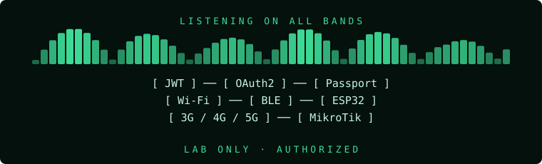

<!-- markdownlint-disable MD033 -->

---

  <h2>⌁ Whoami</h2>

**Joseph Páez** — security researcher and technology tinkerer from Ecuador.
I build isolated labs, reproduce issues in authentication libraries for Node.js (JWT, OAuth2, Passport),
and report them to maintainers and vendors through coordinated disclosure. Labs go public once a fix is out.
Trained in telecommunications engineering, I explore networks and radio (Wi-Fi, Bluetooth/BLE, IoT, mobile networks)
and how they come together in smart cities.

---

  <h2>⌁ Signal Scan</h2>

| Band | On my radar |
| :---: | :---: |
| Auth & AppSec |    |
| Web |       |
| Offensive tooling |    |
| Wireless |    |
| Networking & telecom |    |
| Detection |    |
| IoT |    |
| Smart cities |    |

---

  <h2>⌁ Security Research</h2>

| Work | What it is |
| --- | --- |
| [**passport-jwt-265**](https://github.com/area51ec/passport-jwt-265) | Lab for passport-jwt#265: `issuer`, `audience` and `algorithms` silently dropped from `jsonWebTokenOptions` |
| [**DefinitelyTyped#75902**](https://github.com/DefinitelyTyped/DefinitelyTyped/pull/75902) | Typings for `@types/passport-jwt` that reject that misconfiguration at compile time |
| **Coordinated disclosure** | Several reports in progress with maintainers and vendors, published after the fix |
| **Detection engineering** | Snort, Suricata and Zeek rules, plus incident response playbooks for IT/OT environments |

---

  <h2>⌁ Community</h2>

- **Founder of the Area51 community** for security and technology: in-person talks and, during the pandemic, webinars with security experts from Colombia, Chile, Bolivia, Ecuador, Spain, Argentina, Mexico, Peru, Costa Rica and England
- **Collaborator at The Hacking Day**, Ecuador chapter
- **Collaborator at Campus Party**
- Official distributor of **0xWord** security books in Ecuador

---

  <h2>⌁ Training</h2>

-0B2A22?style=for-the-badge&logo=mikrotik&logoColor=3DDC97)
-134E3F?style=for-the-badge&logo=mikrotik&logoColor=C8F5E1)

---

  <h2>⌁ Building</h2>

| Project | Signal |
| :---: | :---: |
| Voice assistant for hotels | Embedded voice device with sensors |
| Smart traffic lights (smart city) | Adapt to traffic, weather and emergency routes |
| Electronic invoicing | Direct integration with Ecuador's tax authority (SRI) |

---

  <h2>⌁ Stack</h2>

---

All testing is done on my own equipment and networks, or with explicit authorization.

